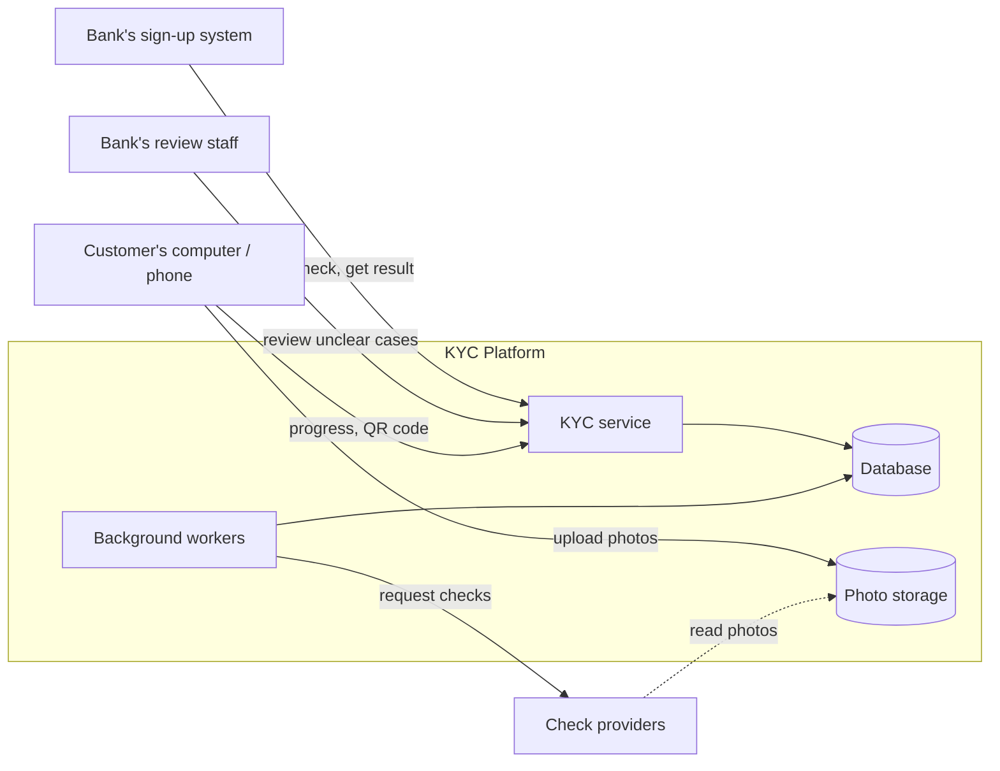
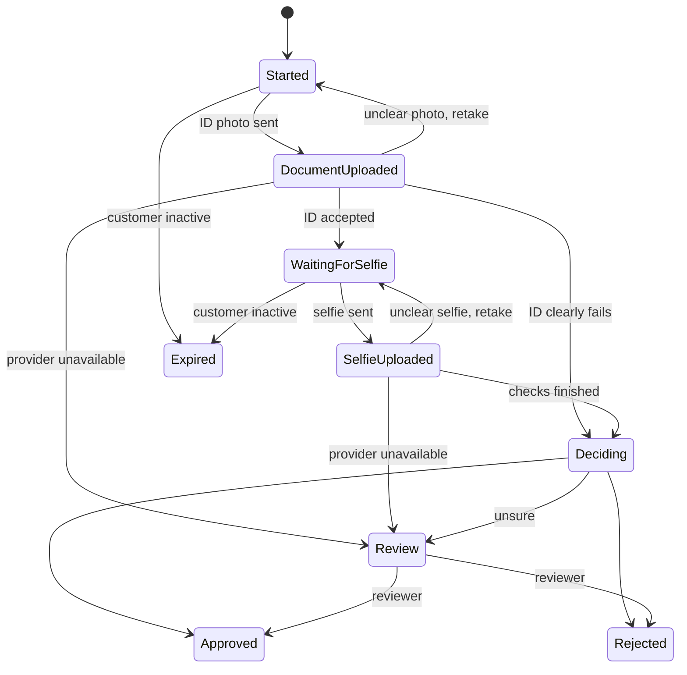

# KYC Verification Platform: Architecture

When a bank signs up a new customer online, it must confirm the person is who they say they are
("Know Your Customer", or KYC). This platform runs that check. The customer photographs their ID document
and takes a selfie; specialist **check providers** confirm the document is genuine, that a live person is
present, and that the face matches the ID. Our platform does not do those checks itself. Its job is to:

- guide each verification through its steps reliably, even if the customer switches from computer to phone;
- reach a clear, explainable result (**Approved**, **Rejected**, or **sent to a person for review**);
- keep a permanent record of everything that happened, as the law requires (POPIA, FICA);
- avoid being locked in to any single check provider;
- collect the clues needed to spot fraud;
- grow from hundreds to tens of thousands of checks a day without being rebuilt.

## 1. The big picture

Several banks can use the platform at once. Each bank has its own secret key, and can only ever see its
own customers. Each customer's device gets its own temporary pass that only opens that customer's
verification, so one customer can never reach another's data.

## 2. A customer's journey

1. The bank's system asks the platform to start a verification and gets back a link to show the customer.
2. If the customer is on a computer, the page shows a **QR code**. Scanning it moves the session to their
   phone. The code works once, for five minutes, so a photo of someone else's screen is useless.
3. The phone uploads the ID photo straight to secure photo storage (it does not pass through our service,
   which keeps the service fast even when many people upload at once).
4. In the background, a worker sends the photo to the document check provider and records the answer.
5. The customer takes a selfie; workers run the "is this a live person" and "does the face match" checks.
6. The platform combines the results into a decision. Both the computer and the phone show progress.
7. The bank's system collects the result. Unclear cases go to the bank's own review staff.

Customers never see scores or technical reasons, only what to do next (for example "please retake the
photo"). Steps that wait on a provider happen in the background, so the customer is never left staring
at a frozen screen.

## 3. The main parts

| Part | What it does | Why it is built this way |
|---|---|---|
| **KYC service** | Receives every request from banks, customers' devices and reviewers | Holds no memory between requests, so more copies can be added when busy |
| **Background workers** | Carry out each step: check document, check liveness, match face, decide | Work is written down as a to-do list in the database, so nothing is lost if a worker stops |
| **Provider connectors** | Translate between our platform and each check provider | Every provider's answer is converted into the same simple form, so a provider can be swapped by changing settings |
| **Decision rules** | Turn check results into Approved, Rejected or Review, with reasons | Rules carry a version number, so any past decision can be explained later |
| **Clean-up jobs** | Close abandoned verifications; delete photos once no longer needed | Keeping data only as long as necessary is automatic, not a manual task |
| **Database** | The single source of truth: banks, verifications, results, records | One place means the status, the history and the to-do list always agree |
| **Photo storage** | Holds ID photos and selfies | Phones upload directly using one-time links; in production, photos are encrypted and auto-deleted by the storage too |

The service and the workers are the same program started in two modes. They grow for different reasons
(more visitors vs. more checks waiting), so each can be scaled up separately.

## 4. Stages of a verification

The rules behind this picture:

- **A verification can only move along these arrows.** Any other change is refused, and every move is
  recorded.
- **Retakes only for problems the customer can fix**, such as a blurry photo, and at most three times.
  A clear failure (a tampered document, a photo of a photo) goes straight to a decision.
- **A provider outage never rejects a customer.** If a provider is down, the platform keeps retrying; if
  it still fails, the case goes to a person instead.
- **Only a waiting customer can time out.** If the delay is on our side or the provider's, the customer
  does not lose their progress.

## 5. What is stored

- **Banks** and their secret keys. Keys are stored scrambled (like passwords) and can be replaced at any time.
- **Verifications**: the current stage, how many attempts were used, when it expires, and fraud clues.
- **Check results**: one record per provider answer, including which provider gave it.
- **Decisions**: a history, not just the final answer. If the system sent a case to review and a person
  then approved it, both are kept, along with who the reviewer was.
- **The audit record**: an entry for every event (who did what, when, from where). The database itself
  refuses to change or delete these entries. It holds no personal details, only references.
- **Photos** sit in photo storage, not the database, and are deleted after a period each bank chooses.

## 6. When things go wrong

- **Saving is all-or-nothing.** A change of stage, its audit entry and the next to-do item are saved
  together, so a crash can never leave them out of step.
- **No lost work.** Each worker "borrows" a to-do item for a short time. If the worker crashes, the item
  is handed to another worker. Running a step twice is harmless, because each step first checks whether
  it was already done.
- **Slow or failing providers.** Each call has a time limit. If a provider keeps failing, the platform
  pauses calls to it briefly rather than piling on. Failed steps are retried with growing gaps (from
  seconds up to five minutes); after that the case goes to a person.
- **Two changes at once.** If two requests try to change the same verification at the same moment,
  one succeeds and the other is told to try again.

## 7. Keeping personal data safe

- **Minimum personal data.** The ID number is stored only as a scrambled fingerprint. That still lets us
  notice the same document being used twice, but the number cannot be recovered from it. Other identity
  details are encrypted.
- **Short-lived links.** Upload links work for five minutes, for one file of the declared type. Once a
  photo is received it is moved where the customer can no longer replace it, and its contents are checked
  again before every provider sees it.
- **Limited views.** Reviewers see a partly hidden ID number and photo links that expire quickly; every
  look at personal data is recorded against the reviewer's name.
- **Retention and erasure.** Photos are deleted after the bank's chosen period. Records the law requires
  (FICA: five years) are kept. To erase a person, their encrypted details are made unreadable by
  destroying the key, while the legally required record remains.

## 8. Seeing what is happening

Every request gets a tracking number that follows the verification through the service, the workers and
the audit record, so support staff can trace one customer's journey end to end. The platform reports
how long checks are waiting, how each provider is performing and how many decisions of each kind are
made. Suggested alarms: checks waiting more than a minute, a provider being paused, any case that ran out
of retries, or more cases going to review than usual.

## 9. Growing with demand

50,000 checks a day is less than one new customer per second on average; even a busy marketing campaign
(20 times normal) is about 12 per second. The database can easily handle that. **The real limit is the
check providers**: each answer takes a couple of seconds, so the platform simply runs more checks side by
side.

| Stage | Volume | What changes |
|---|---|---|
| **Today** | Hundreds a day | One service, one worker, one database, as built |
| **Growth** | 10,000–50,000 a day, with peaks | Add copies of the service and workers automatically when busy; a read-only database copy for reviewers; split the audit record by month; cap how hard each provider is pushed |
| **Beyond** | 100,000+ a day | Move the to-do list to a dedicated messaging system; providers call us back instead of us waiting; fraud scoring becomes its own service |

Photos go straight to storage and work waits safely in the to-do list, so a sudden rush slows things
down a little instead of breaking them.

**Fraud readiness.** Already captured: the device and network each customer used, the scrambled ID
number, a fingerprint of every photo (to catch the same selfie used twice), and failed QR-code attempts.
These raise a case for review rather than rejecting outright, and reviewers can see linked verifications.

## 10. Key decisions

| Question | What we chose | What we did not choose, and why |
|---|---|---|
| One bank or many? | Many banks, fully separated, each with its own keys and photo-keeping period | One shared setup: keys could not be replaced and banks could not be kept apart |
| One program or many? | One program with two modes (service and worker) | Many small services: more moving parts with no benefit at this size |
| How are steps run? | Our own step-by-step controller with a to-do list in the database | A dedicated workflow product: sensible later if there are many kinds of verification, too heavy today |
| Where does the to-do list live? | In the main database, saved together with each change | A separate messaging system: adds the risk of the two getting out of step, with no speed benefit yet |
| How is history kept? | Current state plus a permanent, unchangeable audit record | Rebuilding state from events: complex and hard to square with the right to be forgotten |
| Check providers | One connector per provider, chosen in settings | Switching providers automatically mid-check: not needed; the goal is being able to replace one |
| Retakes | Only for fixable problems, three at most | Unlimited retakes: lets fraudsters keep testing the system and wastes provider fees |
| Customer access | A temporary pass per device that only opens that customer's check | Putting the verification number in links: easy to guess or share |
| Reviewers | The bank's own staff, identified by name on every decision | Separate reviewer accounts on our side: the reviewers belong to the bank |
| Telling the bank the result | The bank asks for it; automatic notifications are designed for later | Building notifications now: extra work that does not change the core design |
