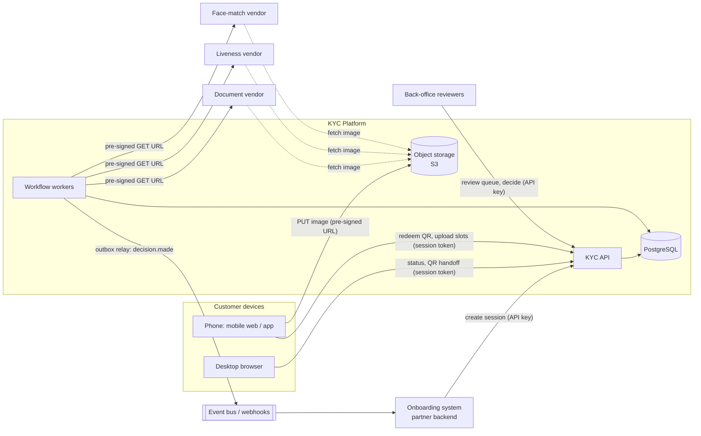
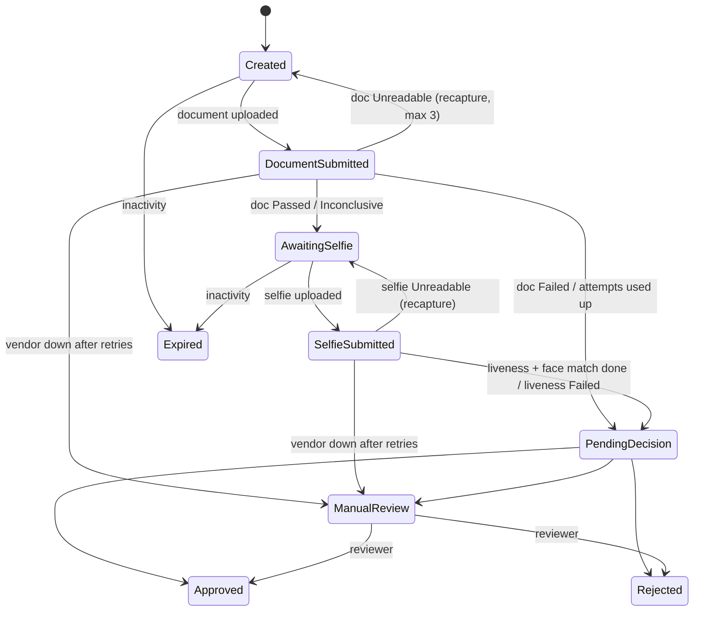
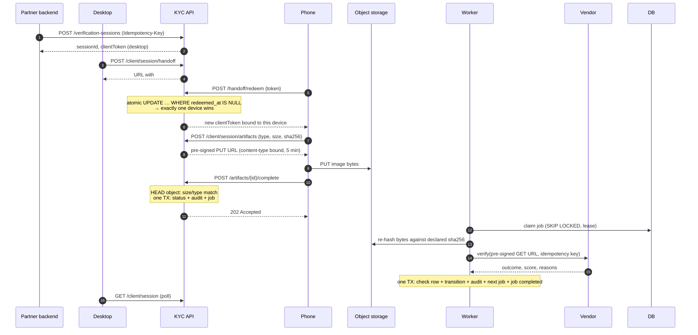
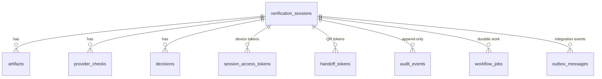

# KYC Verification Platform: Architecture

## 1. Purpose and scope

The platform runs digital identity verification for onboarding. It does **not** do document validation,
liveness detection or face matching itself. Those are external vendor capabilities. Its job is to:

- run the verification **workflow** reliably and keep **session state** across devices;
- make a **decision** (Approved / Rejected / ManualReview), with explainable reasons and a human-review path;
- keep a complete, tamper-resistant **audit trail** (POPIA/GDPR, FICA/AML);
- stay **vendor-independent**, and capture the signals that future **fraud** controls need;
- grow from hundreds to tens of thousands of verifications a day **without a redesign**.

## 2. System context

**Trust boundaries.** Partners and reviewers are authenticated machines or staff (`X-Api-Key`; in production,
OAuth2 client credentials or mTLS at the gateway). Customer devices hold a **session-scoped opaque bearer token**.
The token decides which session a request acts on, so customer routes take no session id and one customer
can't reach another's session.

## 3. Major components

| Component | Responsibility | Key decisions |
|---|---|---|
| **KYC API** (ASP.NET Core minimal APIs) | Session lifecycle, QR handoff, upload slots, status, review, audit queries | Stateless, so it scales out. RFC 7807 errors with stable `code`s. Idempotency keys. Rate limits per session and per client |
| **Workflow workers** (same binary, `Kyc__Roles=worker`) | Run each step as a durable job: validate document → liveness → face match → risk & decision | Postgres job queue with `FOR UPDATE SKIP LOCKED` and leases. At-least-once delivery, idempotent handlers. Exponential backoff, then dead letter |
| **Provider adapters** | Vendor-neutral `IDocumentVerificationProvider`, `ILivenessProvider`, `IFaceMatchProvider` | Outcomes and scores normalised to `Passed/Failed/Unreadable/Inconclusive` with a score in [0,1]. A Polly timeout and circuit breaker per vendor. Vendor chosen per capability in config |
| **Decision engine** | Pure function: check results + risk signals → outcome + reason codes + risk score | Versioned rules (`rulesVersion` stored on each decision); thresholds in config; reject > review > approve |
| **Outbox relay** | Publishes `decision.made` / `session.status_changed` to downstream systems | Written in the same transaction as the state change, so delivery is exactly-once-effective (at-least-once with a dedupe id) |
| **Maintenance** | Expire abandoned sessions; purge images after retention | Data minimisation is automated, not left as a manual procedure |
| **PostgreSQL** | System of record: sessions, checks, decisions, tokens, audit, jobs, outbox | One transactional store keeps state, audit, jobs and events consistent |
| **Object storage (S3)** | Document and selfie images | Pre-signed PUT/GET, so the API never streams image bytes; SSE-KMS and lifecycle rules in production |

**Why one deployable with two roles?** API and worker share the domain model and data access but scale on
different signals (request rate vs. queue lag). One codebase avoids drift; separate deployments
(`docker compose up --scale worker=N`) keep the scaling independent.

**Technology choices.** .NET 10 (current LTS; .NET 8 reached end of support on 10 Nov 2026) for performance,
mature async I/O, and a long-supported runtime that suits a regulated platform. PostgreSQL for transactional
integrity and because `SKIP LOCKED` makes a capable queue without adding a broker. S3-compatible storage is the
standard for large binaries, and pre-signed URLs offload upload bandwidth.

## 4. Workflow design

### 4.1 State machine

Status changes only through `VerificationSession.TransitionTo`, which checks a single transition table and emits an
audit event. Only states that wait on the **customer** can expire. A session the **platform** is processing never
expires, so a slow vendor can't cost the customer their progress.

**Routing rules.** Only problems the customer can fix (image quality) earn a retry. A definitive failure (tampering,
spoof) goes straight to the decision, so we don't spend vendor fees or customer time on a lost cause. Inconclusive
results carry on and end in manual review. **A vendor outage never auto-rejects a customer**: after retries run
out, the session goes to ManualReview with `PROVIDER_UNAVAILABLE`.

### 4.2 Cross-device handoff and upload sequence

The handoff token goes in the URL **fragment**, which browsers never send to servers, so it stays out of access logs,
proxies and `Referer` headers. Only its SHA-256 is stored. Issuing a new QR code revokes any earlier unredeemed ones,
and a replayed or expired token is audited (`handoff.redeem_failed`) as a possible sign of a stolen QR. Both devices
keep valid tokens, so the desktop can keep showing progress. Each device's token, IP and user agent are recorded,
and every upload records which device token made it.

## 5. Data model

- **verification_sessions**: aggregate root: status, attempt counters, expiry, `xmin` optimistic concurrency,
  `(client_id, idempotency_key)` unique, fraud signals (`created_ip`, `device_fingerprint`,
  `document_number_hash`), and `extracted_identity_encrypted` (AES-256-GCM, key id prefix for rotation).
- **artifacts**: metadata only (storage key with no PII, declared sha256, integrity flag, uploading token). Status
  `PendingUpload → Uploaded → Purged`.
- **provider_checks**: one row per vendor result: provider name, vendor reference, normalised outcome/score,
  reason codes, attempt, latency. A unique `(artifact_id, type)` index backs up handler idempotency.
- **decisions**: an append-style history. A system `ManualReview` followed by a reviewer `Approved` shows **whether
  and how a human stepped in**. It stores `rules_version` and `risk_score` so decisions can be replayed.
- **audit_events**: append-only (a DB trigger blocks UPDATE/DELETE/TRUNCATE), with actor type/id,
  correlation id, IP, and a JSON payload of ids, codes and hashes only (**no raw PII**).

Ids are UUIDv7 (time-ordered, so index inserts stay local). Enums are stored as strings for readable forensic queries.

## 6. Reliability

| Failure | Handling |
|---|---|
| Crash between state change and enqueue | Impossible: the state change, audit row, next job and outbox row commit in **one transaction** |
| Worker dies mid-job | Lease (`locked_until`) runs out → another worker reclaims it. Handlers are idempotent: they check the session state before acting, and the handler's writes plus `job=Completed` commit together |
| Vendor slow / failing | Per-vendor timeout and circuit breaker (fail fast). The job is rescheduled with exponential backoff and jitter (2s → 5 min). After 5 attempts: dead letter, and the session goes to ManualReview |
| Duplicate client requests | `Idempotency-Key` on session create (unique index, race-safe). `complete` is idempotent. Handoff redeem is an atomic compare-and-set |
| Two devices / reviewers writing at once | `xmin` optimistic concurrency → `409 concurrent_modification` for the loser |
| Downstream system down | The outbox relay retries in order, and consumers dedupe on the message id |
| DB connectivity blip | The worker loop backs off. The API returns 5xx and the client retries with the same idempotency key |

## 7. Security and compliance

- **Data minimisation**: the document number is kept only as an **HMAC** (keyed, so it can't be brute-forced), which
  is enough to link repeat attempts. Other extracted identity data is field-encrypted. Images are deleted
  `ImageRetentionDays` after the decision by the maintenance job (an S3 lifecycle rule is the backstop). Decision
  and audit records are kept for the FICA retention period (5 years).
- **Least exposure**: customers get no reason codes or scores (they would coach fraudsters). Reviewers see a
  masked document number and **short-lived** image links, and every case opened is audited (`artifact.viewed_by_reviewer`).
- **Uploads**: pre-signed URLs are bound to key + content type and expire in 5 minutes. Size and type are checked
  on confirmation, and the bytes are **re-hashed** before any vendor sees them.
- **Tokens**: random 256-bit, opaque, stored as hashes, revocable. API keys are compared in constant time.
- **Abuse**: rate limits per IP (redeem), per session, and per client. In production these move to the gateway or WAF
  alongside bot protection.
- **Data subject rights**: `applicant_reference` links all of a person's sessions for access requests. Erasure means
  crypto-shredding the identity field and purging images, while the audit/decision records required by AML law are kept.

## 8. Observability

- **Correlation**: `X-Correlation-Id` (or the trace id) goes into the log scope, audit events, jobs and worker logs,
  so one id follows a session from the HTTP request through every async step.
- **Structured JSON logs**, never containing tokens, document numbers or names.
- **Metrics** (OpenTelemetry → Prometheus `/metrics`): `kyc.jobs.queue_lag` (**worker autoscaling signal**),
  `kyc.provider.calls`/`latency` by vendor and outcome (vendor health and SLA), `kyc.decisions` by outcome and
  decider (drift in approval rate, manual-review load), handoff results, sessions created.
- **Tracing**: ASP.NET Core and workflow spans with an OTLP exporter. `/health/live` and `/health/ready` (database) for orchestrators.
- **Suggested alerts**: queue lag p95 > 60s; a vendor circuit open; dead-letter count > 0; ManualReview rate
  above baseline; outbox backlog growing.

## 9. Scaling approach

**Load estimate.** 50k verifications a day ≈ 0.6/s on average. A campaign at 20× gives ~12 sessions/s, which is
~50 workflow jobs/s and ~150 API req/s (with status polling). Postgres with `SKIP LOCKED` handles thousands of
job claims a second, so **the database isn't the first bottleneck. Vendor latency and rate limits are.**
At 2 s per vendor call, 50 jobs/s means ~100 calls in flight, i.e. a few worker replicas with higher async concurrency.

| Stage | Volume | What changes |
|---|---|---|
| **Now** | 100s/day | 1 API + 1 worker, single Postgres, as built |
| **Growth** | 10k–50k/day, spikes | Scale API replicas on CPU/RPS and workers on `queue_lag`. Raise `MaxConcurrency` (vendor I/O is async). Read replica for the review queue and investigations. Partition `audit_events` by month. Per-vendor concurrency caps so we stay inside vendor rate limits |
| **Beyond** | 100k+/day, multi-product | Swap the Postgres queue for SQS/RabbitMQ/Kafka behind the same `IJobHandler` contract (the outbox relay already decouples publishing). Vendor webhooks instead of synchronous calls. Server-Sent Events/push instead of polling. Fraud scoring as its own service consuming the event stream |

**Spikes.** Uploads go straight to S3, so the API absorbs bursts cheaply. Work queues up durably instead of failing,
and the customer sees `WAIT` while workers catch up.

**Without a redesign.** The seams are already there: the provider adapter interface (multiple vendors, routing or
fallback per capability), the job handler interface (swap the transport), the outbox (swap the publisher),
and `RiskSignals` (add a fraud vendor or a velocity service without touching the workflow).

## 10. Fraud readiness

Captured today and indexed for investigation: device fingerprint, IP and user agent per session and per device token;
handoff redemption IP/UA; document-number HMAC; image SHA-256 (catches the same selfie reused across sessions); an
audit trail of failed QR redemptions. These already feed the decision as **review triggers** (repeat attempt after
rejection, concurrent sessions for the same document, IP velocity, reused selfie) rather than auto-rejects, which
keeps false positives with a human. Reviewers see related sessions linked by document hash.
