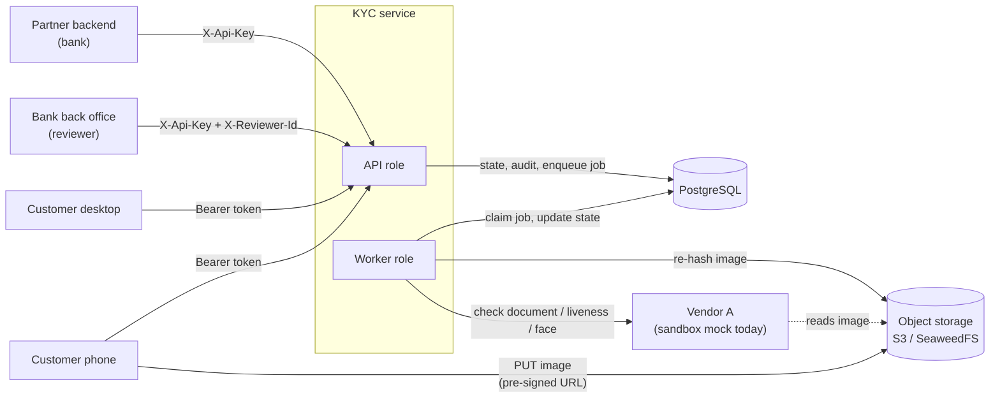
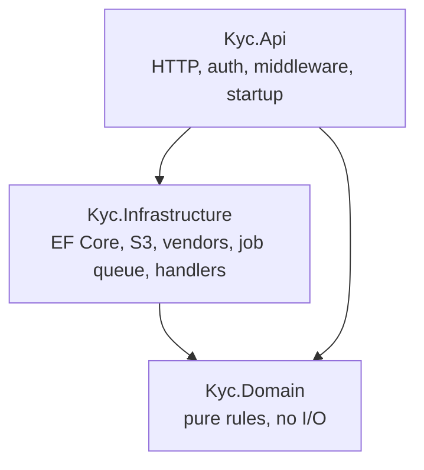
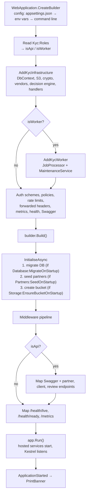
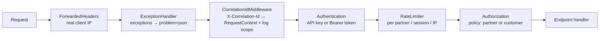
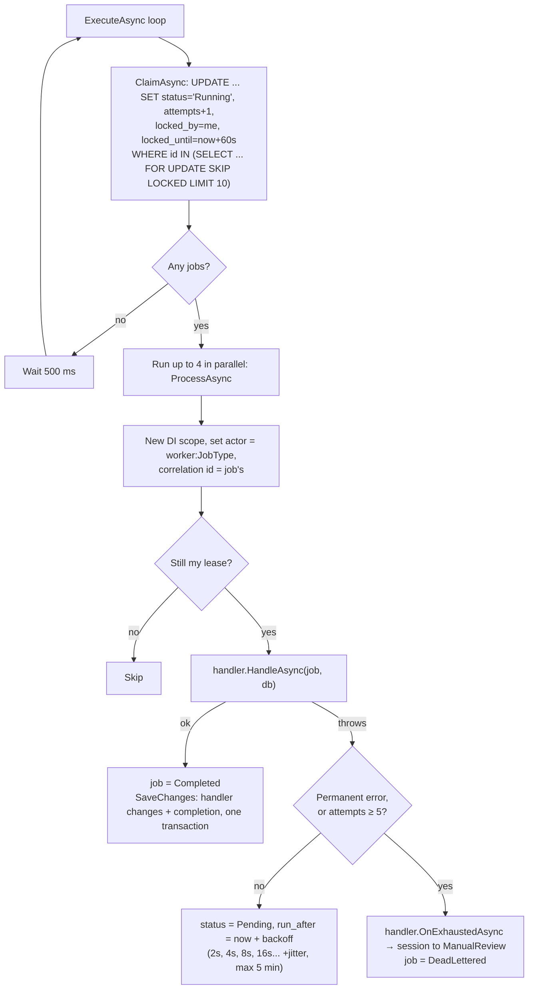
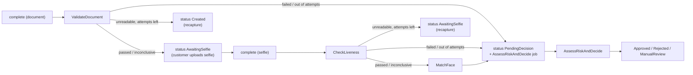
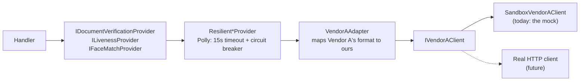
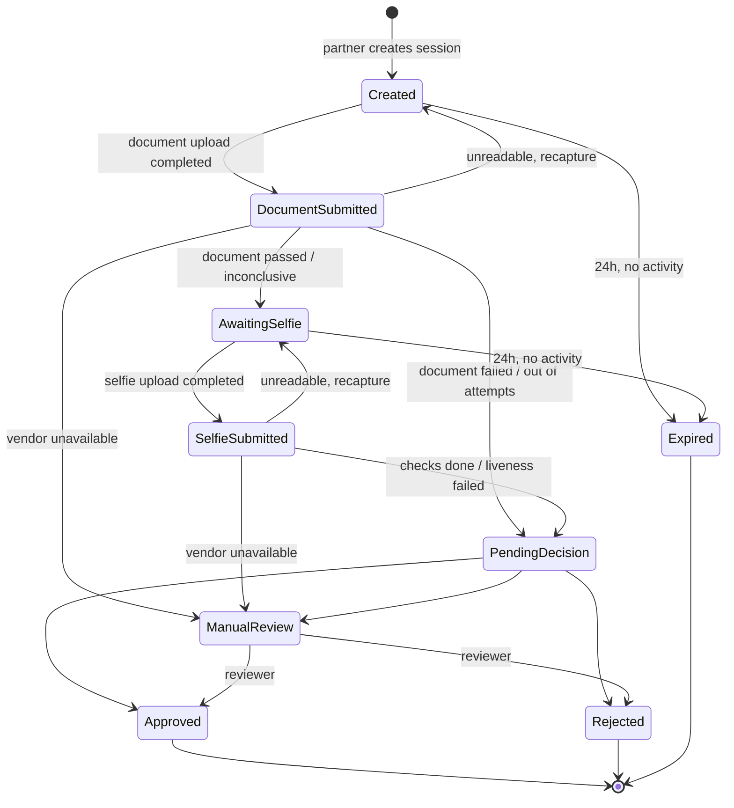
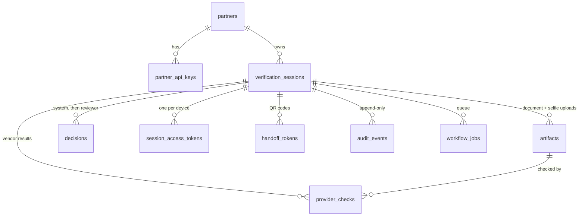
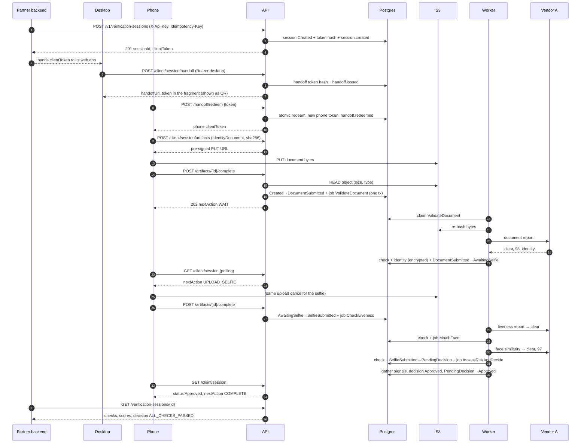

# Code walkthrough

A start-to-finish tour of the KYC service: how it boots, what each endpoint does, where the work goes, and which code
runs in each scenario. Read it top to bottom once, then use it as a map.

Companion docs: [`ARCHITECTURE.md`](ARCHITECTURE.md) (the why, at system level) and [`DECISIONS.md`](DECISIONS.md)
(each design decision and its trade-offs).

**Contents**

1. [The short version](#1-the-short-version)
2. [Map of the code](#2-map-of-the-code)
3. [Starting it up](#3-starting-it-up)
4. [What happens on every HTTP request](#4-what-happens-on-every-http-request)
5. [Who can call what (auth)](#5-who-can-call-what-auth)
6. [The endpoints, one by one](#6-the-endpoints-one-by-one)
7. [The worker: job queue and handlers](#7-the-worker-job-queue-and-handlers)
8. [The vendor layer and the mock](#8-the-vendor-layer-and-the-mock)
9. [The decision engine](#9-the-decision-engine)
10. [The state machine](#10-the-state-machine)
11. [The audit trail](#11-the-audit-trail)
12. [Background maintenance](#12-background-maintenance)
13. [Data model](#13-data-model)
14. [Scenarios: what code runs](#14-scenarios-what-code-runs)
15. [Concurrency and edge cases](#15-concurrency-and-edge-cases)
16. [Debugging cheat sheet](#16-debugging-cheat-sheet)
17. [C# building blocks: the kinds of types and methods used](#17-c-building-blocks-the-kinds-of-types-and-methods-used)

---

## 1. The short version

A bank (the **partner**) wants to verify a customer's identity. Its backend calls us to start a **session**. The
customer, on a desktop or phone, uploads a photo of their **ID document** and a **selfie**. We send those to a
**vendor** for three checks (document authenticity, liveness, face match), run our own **decision rules**, and end
with **Approved**, **Rejected** or **ManualReview**. A bank staff member (**reviewer**) settles the manual reviews.
Every step goes into an append-only **audit trail**.

There's one codebase that runs in two **roles**:

- **api**: answers HTTP requests. It never calls a vendor and never waits on slow work.
- **worker**: picks jobs off a queue (a Postgres table) and does the slow work: calling vendors and deciding.

Everything they share lives in **Postgres** (state, queue, audit). Images live in **S3-compatible object storage**
and go there directly from the customer's device.



---

## 2. Map of the code

Three projects, layered so the inner one knows nothing about the outer ones. If a C# keyword below is unfamiliar
(`sealed`, `record`, `static`, extension methods...), see [section 17](#17-c-building-blocks-the-kinds-of-types-and-methods-used).



| Folder / file | What lives there |
|---|---|
| **`src/Kyc.Domain`** | |
| `VerificationSession.cs` | The aggregate. Every status change and audit event goes through it. |
| `SessionStateMachine.cs` | The table of allowed status changes. |
| `Entities.cs` | `Artifact`, `ProviderCheck`, `Decision`, `HandoffToken`, `SessionAccessToken`, `AuditEvent`, `WorkflowJob`. |
| `Partner.cs` | Tenants and their hashed API keys. |
| `Decisioning/DecisionEngine.cs` | Pure function: check results + risk signals → outcome. Also `ReasonCodes`. |
| `Workflow/WorkflowRules.cs` | After a check, what next (continue / recapture / decide), and retry backoff. |
| `Enums.cs`, `DomainExceptions.cs`, `AuditEventTypes.cs` | Statuses, errors, audit event names. |
| **`src/Kyc.Infrastructure`** | |
| `DependencyInjection.cs` | Registers everything. Picks the vendor per capability. |
| `Persistence/KycDbContext.cs` | EF model, indexes, and `SaveChangesAsync`, which turns domain events into audit rows. |
| `Persistence/Migrations/` | Schema, plus the trigger that makes `audit_events` append-only. |
| `Persistence/PartnerSeeder.cs` | Creates dev partners and keys from config. |
| `Workflow/JobQueue.cs` | `Enqueue` and `ClaimAsync` (the `SKIP LOCKED` query). |
| `Workflow/JobProcessor.cs` | The worker loop: claim, run handler, retry or dead-letter. |
| `Workflow/Handlers/` | One handler per job type. |
| `Providers/ProviderContracts.cs` | Vendor-neutral interfaces and result types. |
| `Providers/ResilientProviders.cs` | Polly timeout + circuit breaker around each vendor. |
| `Providers/VendorA/` | Vendor A adapter, wire models, options, and the sandbox client (the mock). |
| `Storage/ObjectStorage.cs` | S3 client: pre-signed URLs, metadata, read, delete. |
| `Security/Crypto.cs` | Token generation/hashing, AES-GCM field encryption, HMAC for ID numbers. |
| `Maintenance/MaintenanceService.cs` | Expires abandoned sessions, purges old images. |
| `Common/RequestContext.cs` | Who is acting and the correlation id, stamped on audit rows. |
| `Observability/KycTelemetry.cs` | Metrics and the activity source. |
| **`src/Kyc.Api`** | |
| `Program.cs` | Startup: roles, DI, auth, rate limits, middleware order, endpoints, banner. |
| `Auth/Authentication.cs` | API key handler and session token handler. |
| `Endpoints/PartnerEndpoints.cs` | Create session, get session, get audit trail. |
| `Endpoints/ClientEndpoints.cs` | Customer device: status, QR handoff, redeem, uploads. |
| `Endpoints/ReviewEndpoints.cs` | Review queue, open case, decide. |
| `Contracts/Contracts.cs` | Request/response records and the `NextAction` mapping. |
| `Infrastructure/Middleware.cs` | Correlation id middleware and exception → problem+json mapping. |
| **`tests/`** | Unit tests (domain, no I/O) and integration tests (real Postgres + S3 in containers). |
| **`scripts/demo.ps1`** | Drives every scenario end to end over HTTP. |

---

## 3. Starting it up

### 3.1 Locally

| Goal | Command |
|---|---|
| Everything in Docker | `docker compose up --build` |
| Infra in Docker, app in Visual Studio | `docker compose up -d postgres s3`, then F5 on `Kyc.Api` |
| Run the scenarios | `.\scripts\demo.ps1 -Scenario all` |
| Unit tests | `dotnet test tests/Kyc.UnitTests` |
| Integration tests (needs Docker) | `dotnet test tests/Kyc.IntegrationTests` |

In Docker you get **two app containers** from the same image: `api` (`Kyc__Roles=api`, port 8080) and `worker`
(`Kyc__Roles=worker`, no published port). From Visual Studio you get **one process** running both roles
(`appsettings.json` defaults to `"Roles": "api,worker"`).

Ports: API `localhost:8080`, Postgres `localhost:5432`, S3 `localhost:9000`.

### 3.2 What happens at boot (`Program.cs`)



Step by step:

1. **Config** is layered: `appsettings.json`, then environment variables (`Storage__ServiceUrl` overrides
   `Storage:ServiceUrl`), then command-line args. `docker-compose.yml` uses env vars to point at the `postgres` and
   `s3` containers.
2. **Roles** decide what gets registered. The worker role adds two `BackgroundService`s: `JobProcessor` and
   `MaintenanceService`. The API role maps the HTTP endpoints. Health and metrics are mapped for both.
3. **`AddKycInfrastructure`** (`DependencyInjection.cs`) registers:
   - `KycDbContext` (Npgsql, snake_case names);
   - `FieldProtector` and `IdentifierHasher` (crypto);
   - `S3ObjectStorage`;
   - the vendor providers, each wrapped in a resilience decorator;
   - `DecisionPolicy`: rules from `Decisioning`, score thresholds from the vendor's own options;
   - the four `IJobHandler`s.
4. **`InitialiseAsync`** gets the environment ready. In compose only the `api` container migrates and seeds, so two
   containers don't race.
5. **Banner**: once Kestrel is listening, `PrintBanner` writes the real URLs to the console.

### 3.3 In production

Same image, different config. What changes:

| Concern | Local | Production |
|---|---|---|
| Topology | One process, or two containers | `api` deployment behind a load balancer (scale on CPU/RPS); `worker` deployment (scale on queue lag) |
| Migrations | `MigrateOnStartup=true` | A separate release step; `MigrateOnStartup=false` |
| Partners | Seeded from config (`dev-partner-key`) | Created by an admin process; `SeedOnStartup=false` |
| Secrets | Dev keys in `appsettings.json` | `Security:*`, `Storage:*`, connection string from a secrets manager / KMS |
| Object storage | SeaweedFS on `localhost:9000` | AWS S3 (or compatible), HTTPS, server-side encryption; `EnsureBucketOnStartup=false` |
| Vendor | `SandboxVendorAClient` (mock) | A real HTTP client implementing `IVendorAClient` (not built yet) |
| Logs | Simple one-line text | JSON (the default in `appsettings.json`), shipped to a log store |
| Health | | `/health/live` for liveness probes, `/health/ready` (checks the DB) for readiness |
| Metrics | | Scrape `/metrics` (Prometheus format) |
| Forwarded headers | Trusts any proxy | Restrict `KnownIPNetworks` to the load balancer range |
| Rate limits | In-memory per instance | Move to the API gateway or a shared store |

Scaling workers is just more replicas: `ClaimAsync` uses `FOR UPDATE SKIP LOCKED`, so they never take the same job.

---

## 4. What happens on every HTTP request

Middleware order matters, and it's set in `Program.cs`:



- **Correlation id** (`Middleware.cs`): uses the inbound `X-Correlation-Id` if it's valid, otherwise the trace id.
  It goes on the response header, every log line, every audit row and every job the request queues. That's how you
  follow one upload from HTTP call to final decision.
- **Rate limits** run after authentication so they can key on the partner or session instead of IP:
  - `partner`: 600 requests/min per partner;
  - `customer`: 60 requests/min per session;
  - `handoff-redeem`: 10 requests/min per IP (100 in dev and compose).
- **Errors** (`ProblemExceptionHandler`): domain exceptions map to status codes with a stable `code`:

| Exception | Status | Example `code` |
|---|---|---|
| `NotFoundException` | 404 | `not_found` |
| `SessionExpiredException` | 410 | `session_expired` |
| `InvalidStateTransitionException` | 409 | `invalid_state_transition` |
| `SessionStateConflictException` | 409 | `unexpected_artifact`, `attempts_exhausted`, `not_in_review` |
| `DbUpdateConcurrencyException` | 409 | `concurrent_modification` |
| `BusinessRuleException` | 422 | `idempotency_key_reused`, `handoff_invalid`, `upload_not_found` |
| validation (`Problems.Validation`) | 400 | `validation_failed` |
| anything else | 500 | `internal_error` (details only in logs) |

---

## 5. Who can call what (auth)

`Program.cs` registers a **policy scheme** that looks at the request. If there's an `X-Api-Key` header it uses the
API key handler. Otherwise it uses the session token handler.

| Caller | Sends | Handler (`Auth/Authentication.cs`) | Claims | Audit actor |
|---|---|---|---|---|
| Partner backend | `X-Api-Key` | `ApiKeyAuthenticationHandler`: SHA-256 the key, look up `partner_api_keys` (not revoked, partner active) | `partner_id`, role `partner` | `partner:demo-bank` |
| Reviewer (bank back office) | `X-Api-Key` + `X-Reviewer-Id` | Same handler, plus the `RequireReviewer` filter in `ReviewEndpoints` | as above | `reviewer:staff-1042 via partner:demo-bank` |
| Customer device | `Authorization: Bearer <clientToken>` | `SessionTokenAuthenticationHandler`: SHA-256 the token, look up `session_access_tokens` (not revoked, not expired) | `session_id`, `access_token_id`, `channel` | `token:<access token id>` |
| Second device redeeming a QR | nothing (token in the body) | none, `AllowAnonymous` | | `anonymous`, then `token:<new id>` |

Things worth knowing:

- **No plaintext secrets are stored.** API keys, client tokens and QR tokens are random strings. Only their SHA-256
  hash is in the database (`Tokens` in `Crypto.cs`).
- **Customer routes take no session id.** The session comes from the token, so one customer can't reach another's
  session by changing a URL.
- **Partners can't see each other's sessions.** `LoadVisibleSession` returns 404 (not 403) for another partner's
  session, so ids can't be probed.

---

## 6. The endpoints, one by one

Swagger at `/swagger` lists them all. Here is what each one does inside.

### Partner API (`PartnerEndpoints.cs`)

#### `POST /v1/verification-sessions`: start a session

Needs `X-Api-Key` and an `Idempotency-Key` header. Body: `applicantReference`, `channel`, and optional `customer`
(IP, user agent, device fingerprint, which feed fraud signals later).

1. Validate the header and body.
2. Hash the request body. Look for an existing session with this `(partner, Idempotency-Key)`.
   - **Found, same body hash** → *replay*: issue a **fresh** client token (the old plaintext isn't stored) and
     return **200** with the same session.
   - **Found, different body** → **422** `idempotency_key_reused`.
3. Not found → `VerificationSession.Create(...)`: status `Created`, expires in 24 h, records `session.created`.
4. `AccessTokens.Issue(...)` (in `KycApiOptions.cs`) creates a `SessionAccessToken`, valid until the session expires. Only its hash is stored; the plaintext goes back once.
5. `SaveChangesAsync` writes the session, the token and the audit row in one transaction.
   - If two retries race, the unique index on `(partner_id, idempotency_key)` throws. The loser catches it and
     replays the winner's session.
6. Return **201** with `sessionId`, `status`, `expiresAt`, `clientToken`. The partner gives the `clientToken` to its
   front end.

#### `GET /v1/verification-sessions/{id}`: full view

Loads the session with artifacts, checks and decisions (`LoadVisibleSession`) and maps it with `ToView`. This is the
partner's view, so **reason codes, scores and vendor references are included**.

#### `GET /v1/verification-sessions/{id}/events?after=&limit=`: audit trail

Reads `audit_events` for the session in id order, paged with `after` (default limit 100, max 500).

### Customer device API (`ClientEndpoints.cs`)

All of these need `Bearer <clientToken>`, except redeem.

#### `GET /v1/client/session`: poll status

Returns `ToClientView`: `status`, `nextAction`, `recaptureRequested`, attempts remaining and `expiresAt`.
**There are deliberately no reasons**, so a fraudster can't learn which check caught them. `nextAction` is what the
UI should show:

| Session status | `nextAction` |
|---|---|
| `Created` | `UPLOAD_DOCUMENT` |
| `AwaitingSelfie` | `UPLOAD_SELFIE` |
| `DocumentSubmitted`, `SelfieSubmitted`, `PendingDecision`, `ManualReview` | `WAIT` |
| `Approved`, `Rejected` | `COMPLETE` |
| `Expired`, or past `expiresAt` while waiting on the customer | `EXPIRED` |

#### `POST /v1/client/session/handoff`: make a QR code

1. Refuse if the session has expired (410), is finished, or is in manual review (409 `session_complete`).
2. Revoke any unredeemed QR tokens for this session, so only one QR is live.
3. Generate a random token, store its hash in `handoff_tokens` (5 min TTL), and record `handoff.issued`.
4. Return `handoffUrl = {HandoffBaseUrl}#token=...`. The token is in the URL **fragment**, which browsers never send
   to servers, so it stays out of logs and `Referer` headers. The front end draws the QR.

#### `POST /v1/handoff/redeem`: phone scans the QR

Anonymous and rate-limited per IP. Body: `token`, optional `deviceFingerprint`.

1. Hash the token, then run **one atomic `UPDATE ... WHERE redeemed_at IS NULL AND not revoked AND not expired`**.
   Only one caller can flip it, even under concurrency.
2. **0 rows updated** → if the token is known, record `handoff.redeem_failed` with the reason (already redeemed /
   revoked / expired: it might be a stolen QR). Always return the **same** 422 `handoff_invalid`, so nobody can
   probe which tokens exist.
3. **1 row updated** → issue the phone its **own** access token (channel `MobileWeb` if the user agent says Mobile)
   and record `handoff.redeemed`, with which desktop token issued the QR.
4. Return the phone's `clientToken` and the current session view. **Both devices stay valid**, so the desktop can
   keep showing progress.

#### `POST /v1/client/session/artifacts`: ask to upload

Body: `type` (`IdentityDocument` or `Selfie`), `contentType` (jpeg/png), `sizeBytes` (max 10 MB), `sha256`.

1. Validate.
2. `session.AddArtifact(...)` checks this upload is expected now. A document is only accepted in `Created` and a
   selfie only in `AwaitingSelfie`; otherwise you get 409 `unexpected_artifact`. Older unfinished uploads of the same
   type are marked `Superseded`. Records `artifact.upload_requested`.
3. Save, then `CreateUploadUrlAsync` makes a **pre-signed PUT URL** (5 min). The content type is part of the
   signature, so the client can't upload a different type.
4. Return `artifactId`, `uploadUrl`, `method: PUT` and the headers to send.

The device then **PUTs the bytes straight to S3**. The API never handles image bytes.

#### `POST /v1/client/session/artifacts/{id}/complete`: "I've uploaded it"

This is where the workflow starts.

1. Find the artifact in this session. If it's already `Uploaded`, return 202 again (safe to retry).
2. `GetMetadataAsync` asks S3 whether the object exists and checks the size and content type. If not:
   422 `upload_not_found` / `upload_size_mismatch` / `upload_type_mismatch`.
3. `artifact.MarkUploaded`, record `artifact.uploaded`.
4. `session.SubmitArtifact` increments the attempt counter (max 3 each; 409 `attempts_exhausted` after that) and
   moves `Created → DocumentSubmitted` or `AwaitingSelfie → SelfieSubmitted`.
5. **Enqueue a job**: `ValidateDocument` for a document, `CheckLiveness` for a selfie.
6. `SaveChangesAsync`: **status change + audit rows + job in one transaction**. If the process dies before the
   commit, nothing happened; after it, the job is guaranteed to exist.
7. Return **202 Accepted** with the client view (`nextAction: WAIT`).

### Review API (`ReviewEndpoints.cs`)

All need the partner's `X-Api-Key` **and** `X-Reviewer-Id` (the staff id). The `RequireReviewer` filter checks the
header and sets the audit actor to `reviewer:<id> via partner:<id>`.

#### `GET /v1/reviews`

The partner's sessions in `ManualReview`, oldest first, with the latest decision's reason codes and risk score.

#### `GET /v1/reviews/{id}`: open a case

1. Load the session, decrypt the extracted identity (`FieldProtector.Unprotect`) and **mask the document number**
   (`********0101`).
2. Make **2-minute pre-signed GET links** for the uploaded images.
3. Find **related sessions** with the same document number hash (same person, other attempts).
4. Record `artifact.viewed_by_reviewer`. Looking at personal data is itself audited.

#### `POST /v1/reviews/{id}/decision`

Body: `outcome` (`Approved` or `Rejected`), `reasonCode`, `notes`.

1. Validate, then check the session is in `ManualReview` (409 `not_in_review` otherwise).
2. `Decision.Manual(...)` → `session.ApplyDecision(...)` adds a second decision row (the first was the system's
   `ManualReview`), records `decision.made` and moves to `Approved`/`Rejected`.
3. Save. If two reviewers decide at once, the second one gets 409 `concurrent_modification` (row version check).

### Operational endpoints

| Path | What |
|---|---|
| `/health/live` | Process is up (no checks) |
| `/health/ready` | Can reach the database |
| `/metrics` | Prometheus metrics: sessions, uploads, handoffs, provider calls, decisions, job lag/outcomes |
| `/swagger` | API explorer (api role only) |

---

## 7. The worker: job queue and handlers

### 7.1 The queue is a table

`workflow_jobs` columns that matter: `type`, `payload` (JSON, e.g. the artifact id), `status`
(`Pending → Running → Completed | DeadLettered`), `attempts`/`max_attempts` (5), `run_after`, `locked_by`,
`locked_until`, `last_error`, `correlation_id`.

Jobs are only ever added with `db.Enqueue(...)` **before** a `SaveChangesAsync`, so they commit with the state change
that caused them (the transactional outbox pattern).

### 7.2 The loop (`JobProcessor.cs`)



Key points:

- **Which jobs are claimable**: `Pending` jobs whose `run_after` has passed, plus `Running` jobs whose lease
  **expired** (their worker died). That's how a crash recovers on its own.
- **At-least-once delivery**: a job can run twice (e.g. a worker dies after the vendor call but before commit). So
  every handler starts with an **idempotency guard**: "is the session still in the status I expect, and is there no
  check for this artifact yet?" If not, it logs and returns.
- **Retry vs give up** is decided by the exception type (section 8): `TransientProviderException` retries with
  backoff; `PermanentProviderException` gives up at once. A `DbUpdateConcurrencyException` (someone changed the
  session meanwhile) retries after 200 ms.
- **Giving up never strands a customer.** `OnExhaustedAsync` for every handler calls `RouteToManualReviewAsync`,
  which records `check.provider_unavailable` and applies a system `ManualReview` decision with
  `PROVIDER_UNAVAILABLE`. We don't reject someone because of our own outage.

### 7.3 The four handlers (`Workflow/Handlers/`)

They form a chain. Each one queues the next.



**`ValidateDocumentHandler`**

1. Guard: session must be `DocumentSubmitted` and have no document check for this artifact yet.
2. `VerifyIntegrityAsync` (in `HandlerBase`) re-downloads the bytes and compares SHA-256 with what the client
   declared. A mismatch is recorded as an `Unreadable` check from provider `platform` with
   `ARTIFACT_INTEGRITY_MISMATCH`, and the vendor is never called.
3. Call `IDocumentVerificationProvider.VerifyAsync` with a 2-minute download URL. The job id is the vendor
   idempotency key, so retries don't double-bill.
4. `RecordCheck` saves a `ProviderCheck` and records `check.completed`.
5. If the vendor extracted identity data: the document number is stored as an **HMAC** (`document_number_hash`, for
   cross-session matching) and the full identity as **AES-GCM ciphertext** (`extracted_identity_encrypted`).
6. `WorkflowRules.AfterDocumentCheck` picks what's next: `Continue` → `AwaitingSelfie`; `RequestRecapture` → back
   to `Created` with `session.recapture_requested`; `GoToDecision` → `PendingDecision` + queue the decision job.

**`CheckLivenessHandler`**: same shape for the selfie. Liveness runs **before** face match so we don't pay for a face
match on a spoof. `Continue` keeps the status at `SelfieSubmitted` and queues `MatchFace`.

**`MatchFaceHandler`**: compares the selfie with the latest uploaded document image, records the check, then always
goes to `PendingDecision` and queues `AssessRiskAndDecide`.

**`AssessRiskAndDecideHandler`**

1. Guard: session must be `PendingDecision`.
2. `GatherSignalsAsync` queries across sessions:
   - prior **rejected** sessions with the same document hash;
   - other **open** sessions with the same document hash;
   - sessions from the same **IP** in the last 24 h;
   - the same **selfie hash** in another session;
   - **document expired** (decrypts the identity to read the expiry date).
3. Records `risk.assessed`, builds `DecisionInput` from the latest check of each type, and calls
   `DecisionEngine.Decide`.
4. `ApplyDecision` saves the decision (with `rulesVersion` and `riskScore`), records `decision.made` and moves to the
   final status.

---

## 8. The vendor layer and the mock

A call from a handler goes through four layers:



1. **Contracts** (`ProviderContracts.cs`): vendor-neutral. Results are `Passed / Failed / Unreadable / Inconclusive`
   with a score from 0 to 1, reason codes and a provider reference.
2. **Resilience** (`ResilientProviders.cs`): one Polly pipeline per vendor capability. A timeout or open circuit
   becomes a `TransientProviderException`. There are **no retries here**: the job queue retries, and that survives
   a crash.
3. **Adapter** (`VendorAAdapter.cs`) translates:
   - verdict `clear → Passed`, `consider → Inconclusive`, `unidentified → Unreadable`, `rejected → Failed`;
     anything unknown → `Inconclusive` (a human looks, it never auto-passes);
   - score 0–100 → 0–1;
   - sub-checks like `visual_authenticity → TAMPERING_DETECTED`;
   - HTTP errors: 408/429/5xx → `TransientProviderException` (retry), other 4xx → `PermanentProviderException`
     (give up).
4. **Client** (`VendorAClient.cs`): `SandboxVendorAClient` behaves like a vendor sandbox. It waits
   `SandboxLatencyMs` (300 ms), reads the image back from S3, looks for `KYC_MOCK:` markers in the bytes, and answers
   in Vendor A's format:

| Marker in the file | Vendor A answer | Our outcome |
|---|---|---|
| none | `clear`, score 98/96/97 | Passed |
| `DOC_TAMPERED` | `rejected`, 12, `visual_authenticity` | Failed |
| `DOC_BLURRY` | `unidentified`, `image_quality` | Unreadable |
| `DOC_UNCERTAIN` | `consider`, 55 | Inconclusive |
| `DOC_EXPIRED` | `clear`, but expiry date a year ago | Passed (rejected later by the engine) |
| `DOC_NUMBER=X` | sets the extracted document number | (used for repeat detection) |
| `LIVENESS_SPOOF` / `_BLURRY` / `_UNCERTAIN` | rejected / unidentified / consider 62 | Failed / Unreadable / Inconclusive |
| `FACE_MISMATCH` | `rejected`, 21 | Failed |
| `FACE_WEAK` | `consider`, 72 | Inconclusive, score 0.72 |
| `PROVIDER_FLAKY` | HTTP 504 on attempt 1 only | transient → retry → then normal |
| `PROVIDER_DOWN` | HTTP 503 every time | transient → retries run out |
| `PROVIDER_MISCONFIGURED` | HTTP 401 | permanent → no retries |

Without a `DOC_NUMBER` marker, the document number is derived from the file's hash, so the same file always gives
the same number.

**Swapping the vendor**: write an HTTP `IVendorAClient` (same adapter), or add a `VendorB/` folder with its own
adapter and a case in `DependencyInjection.AddProviders`, chosen per capability with `Providers:Document`,
`Providers:Liveness` and `Providers:FaceMatch`. The score thresholds live in the vendor's options, because one
vendor's 0.85 doesn't mean the same as another's.

---

## 9. The decision engine

`DecisionEngine.Decide` is a pure function, unit-tested with no database. It collects **reject** reasons and
**review** reasons, then: **any reject → Rejected; else any review → ManualReview; else Approved.**

| Input | Rule | Effect |
|---|---|---|
| Document | Failed | reject `DOCUMENT_FAILED` |
| | Unreadable / Inconclusive / missing | review |
| | Expired (from extracted identity) | reject `DOCUMENT_EXPIRED` |
| Liveness | Failed | reject `LIVENESS_FAILED` |
| | Unreadable / Inconclusive / missing | review (skipped if the document hard-failed) |
| | Passed but score < 0.80 | review `LIVENESS_LOW_CONFIDENCE` |
| Face match | Failed or score < 0.60 | reject `FACE_MISMATCH` |
| | Not passed, or score < 0.85 | review `FACE_MATCH_LOW_CONFIDENCE` |
| | missing (and not skipped) | review |
| Fraud signals | earlier rejection of the same document | review `REPEAT_ATTEMPT_AFTER_REJECTION` |
| | another open session with the same document | review `CONCURRENT_SESSIONS_SAME_DOCUMENT` |
| | > 10 sessions from this IP in 24 h | review `HIGH_IP_VELOCITY` |
| | same selfie used in another session | review `SELFIE_REUSED` |

Fraud signals only ever send a case to review; they never auto-reject. Each rule also adds to a 0–100 `riskScore`.
The `rulesVersion` (`rules-2026.11.1`) is saved on every automated decision so old decisions can be explained after
the rules change.

---

## 10. The state machine

`SessionStateMachine.cs` holds the allowed moves. `VerificationSession.TransitionTo` is the **only** place status
changes, and it throws `InvalidStateTransitionException` (409) for anything else.



Only the two statuses that wait on the **customer** can expire. A slow vendor never costs a customer their progress.

---

## 11. The audit trail

How an audit row gets written:

1. Domain code calls `session.Record(eventType, data)`. That only adds to an in-memory `PendingEvents` list.
2. `KycDbContext.SaveChangesAsync` turns each pending event into an `AuditEvent` row and stamps it with the actor,
   correlation id and IP from `RequestContext`.
3. The rows are saved **in the same transaction** as the state change, so the trail can't drift from the data.
4. A Postgres trigger (created in the migration) **blocks UPDATE, DELETE and TRUNCATE** on `audit_events`.

Who sets the actor:

| Code path | Actor type | Actor id |
|---|---|---|
| API key auth | Partner | `partner:demo-bank` |
| Review filter | Reviewer | `reviewer:staff-1042 via partner:demo-bank` |
| Session token auth | Customer | `token:<access token id>` (which device) |
| Job processor | System | `worker:ValidateDocument` etc. |
| Maintenance | System | `maintenance` / `retention` |

Event data holds ids, codes and hashes only, never raw personal data.

---

## 12. Background maintenance

`MaintenanceService` runs in the worker role every 60 s (`Retention:SweepIntervalSeconds`):

- **Expire abandoned sessions**: up to 200 sessions in `Created`/`AwaitingSelfie` past `expiresAt` → `Expired`
  (`customer_inactive`). If a customer acted at the same moment, the row version check fails and the next sweep
  retries.
- **Purge images**: for each partner, completed sessions older than that partner's `ImageRetentionDays` (30 for
  demo-bank). Deletes the S3 objects, marks artifacts `Purged` and records `artifact.purged`. Decisions and audit rows
  are kept.

Expiry is also checked **lazily** on every customer request (`HasLapsed`), so a session never looks alive between
sweeps.

---

## 13. Data model



Indexes worth knowing about (`KycDbContext.OnModelCreating`):

- **Idempotency**: unique `(partner_id, idempotency_key)`.
- **Tokens**: unique `token_hash` on access and handoff tokens.
- **Fraud lookups**:
  - `document_number_hash` (partial, only where it isn't null);
  - `(created_ip, created_at)`;
  - artifact `declared_sha256`.
- **One check per artifact per type**: unique `(artifact_id, type)` on `provider_checks`. This is a second guard
  against a duplicate job writing twice.
- **Queue**: partial index on `run_after` where status is `Pending` or `Running`.
- **Concurrency**: `verification_sessions` uses Postgres `xmin` as a row version.

---

## 14. Scenarios: what code runs

Each one matches a `demo.ps1 -Scenario <name>` (marker in brackets).

### 14.1 Happy path (`happy`)



Audit trail you'll see: `session.created`, `handoff.issued`, `handoff.redeemed`, `artifact.upload_requested`,
`artifact.uploaded`, `session.status_changed` (→ DocumentSubmitted), `check.completed` (document),
`session.status_changed` (→ AwaitingSelfie), the same three for the selfie, `check.completed` (liveness),
`check.completed` (face), `session.status_changed` (→ PendingDecision), `risk.assessed`, `decision.made`,
`session.status_changed` (→ Approved). The jobs started by an upload carry that upload request's correlation id.

### 14.2 Tampered document (`doc-tampered`, `DOC_TAMPERED`)

- `ValidateDocument`: vendor says `rejected` → **Failed**. Identity is still extracted and hashed, so a later attempt
  with the same document can be linked.
- `AfterDocumentCheck(Failed)` → `GoToDecision`. The selfie is **never asked for** (no point paying for more checks).
- Engine: document Failed → reject; liveness and face are skipped, not counted as missing.
- **Rejected** `DOCUMENT_FAILED`. Status trail: Created → DocumentSubmitted → PendingDecision → Rejected.

### 14.3 Blurry document, then a good one (`doc-blurry`, `DOC_BLURRY`)

- `ValidateDocument`: `unidentified` → **Unreadable**, attempts used 1 of 3 → `RequestRecapture`.
- Status goes **back to Created** and `session.recapture_requested` is recorded. The client view shows
  `nextAction: UPLOAD_DOCUMENT`, `recaptureRequested: true`, 2 attempts left.
- The phone uploads again (the old artifact stays, the new one gets its own check), the second check passes and the
  flow continues → **Approved**.
- After the 3rd unreadable image, `RequestRecapture` is no longer allowed, so it goes to the decision →
  **ManualReview** `DOCUMENT_UNREADABLE`.

### 14.4 Uncertain document (`DOC_UNCERTAIN`)

`consider` → **Inconclusive** → `Continue` (the selfie is still collected). The engine adds review
`DOCUMENT_INCONCLUSIVE` → **ManualReview**.

### 14.5 Expired document (`DOC_EXPIRED`)

The vendor says `clear`, so the check is Passed and the flow runs to the end. In `AssessRiskAndDecide`,
`GatherSignalsAsync` decrypts the identity and sees the expiry date is in the past → reject `DOCUMENT_EXPIRED` →
**Rejected**.

### 14.6 Spoofed selfie (`liveness-spoof`, `LIVENESS_SPOOF`)

`CheckLiveness`: `rejected` → **Failed** → `GoToDecision`. **Face match never runs.** Engine: reject
`LIVENESS_FAILED` → **Rejected**.

### 14.7 Weak face match, then a reviewer (`face-weak`, `FACE_WEAK`)

- `MatchFace`: `consider`, 72 → Inconclusive, score 0.72. That's between 0.60 and 0.85 → review
  `FACE_MATCH_LOW_CONFIDENCE` → **ManualReview**. The customer sees `WAIT`.
- The reviewer calls `GET /v1/reviews` (it's in the queue), then `GET /v1/reviews/{id}` (masked identity, image
  links, related sessions; `artifact.viewed_by_reviewer`), then `POST .../decision` `Approved`.
- There are now **two** decisions: the system's `ManualReview` and the reviewer's `Approved` (with `reviewerId`).
  Final status **Approved**.

With `FACE_MISMATCH` (score 0.21, below 0.60) it's **Rejected** `FACE_MISMATCH` straight away.

### 14.8 Vendor blips once (`flaky-provider`, `PROVIDER_FLAKY`)

1. Attempt 1: sandbox throws HTTP 504 → adapter → `TransientProviderException`.
2. `HandleFailureAsync`: attempts 1 < 5 → job back to `Pending`, `run_after = now + ~2 s`, `last_error` set. Nothing
   in the session changed, because the handler's changes were never saved.
3. Attempt 2: claimed again, the vendor answers → normal flow → **Approved**. The check row shows `attempt=2`.

### 14.9 Vendor down (`provider-down`, `PROVIDER_DOWN`)

1. Every attempt gets a 503 → retries at about 2, 4, 8 and 16 s.
2. Attempt 5 fails → `attempts ≥ max` → `OnExhaustedAsync` → `RouteToManualReviewAsync`: records
   `check.provider_unavailable` and a system decision `ManualReview` `PROVIDER_UNAVAILABLE`.
3. The status goes `DocumentSubmitted → ManualReview`, and the job is marked **DeadLettered** with the last error.
   This takes about 30 s in the demo.

If many calls fail together, the **circuit breaker** opens (50% failures over at least 10 calls in 60 s) and fails
fast for 30 s, which also surfaces as transient.

### 14.10 Vendor rejects our credentials (`provider-misconfigured`, `PROVIDER_MISCONFIGURED`)

HTTP 401 → `PermanentProviderException` → **no retries**: dead-lettered on attempt 1 → **ManualReview**
`PROVIDER_UNAVAILABLE`. Retrying a bad API key would only waste time.

### 14.11 Same document comes back after a rejection (`repeat-after-reject`, `DOC_NUMBER=RPT900101`)

1. The demo first runs a session with `DOC_NUMBER=RPT900101` + `DOC_TAMPERED` → Rejected. Its
   `document_number_hash` = HMAC("RPT900101").
2. The new session uses a clean image with the same number → same hash.
3. `GatherSignalsAsync`: `PriorRejectionsForSameDocument = 1` → review `REPEAT_ATTEMPT_AFTER_REJECTION` →
   **ManualReview**. The reviewer's case view lists the earlier session under "related sessions".

### 14.12 File swapped after declaring it (integrity)

The client declares hash A but uploads bytes with hash B. `complete` only checks size and type, so it passes.
`VerifyIntegrityAsync` in the worker catches it and records an Unreadable check from `platform` with
`ARTIFACT_INTEGRITY_MISMATCH` plus `artifact.integrity_failed`. **The vendor never sees the file.** This counts as
unreadable, so the customer is asked to recapture.

### 14.13 Customer walks away

Nobody uploads for 24 h. `GET /client/session` already shows `EXPIRED` (lazy check), any upload or handoff call gets
**410** `session_expired`, and within a minute the maintenance sweep moves it to `Expired` with an audit row.

---

## 15. Concurrency and edge cases

| Situation | What protects it | Result |
|---|---|---|
| Partner retries create with the same key | Unique index + request hash | Same session (200), fresh token |
| Same key, different body | Request hash compare | 422 `idempotency_key_reused` |
| Two phones scan the same QR at once | Atomic `UPDATE ... WHERE redeemed_at IS NULL` | Exactly one wins; the other gets 422 `handoff_invalid` |
| Desktop makes a new QR | Older unredeemed tokens revoked | Old QR gives `handoff_invalid` |
| Desktop and phone change the session at once | `xmin` row version | Second write gets 409 `concurrent_modification` |
| Two reviewers decide at once | `xmin` row version | Second gets 409 |
| Retried `complete` (double tap) | Artifact already `Uploaded` → same 202 | No duplicate job |
| Worker dies mid-job | Lease expires after 60 s; job is claimable again | Runs again; handler guard skips it if already done |
| Job runs twice anyway | Handler guards + unique `(artifact_id, type)` on checks | No duplicate check |
| Worker and customer race (worker changes status) | `xmin` on the session | Worker retries in 200 ms |
| Selfie uploaded before the document | `ExpectedArtifact` check | 409 `unexpected_artifact` |
| Upload after 3 attempts are used | Session has already moved on to the decision | 409 `unexpected_artifact` (`attempts_exhausted` is a backstop) |
| Another partner's session id | `LoadVisibleSession` | 404 |

---

## 16. Debugging cheat sheet

Connect with `psql -h localhost -U kyc kyc` (password `kyc`), or any SQL client.

```sql
-- Where is a session, and what happened to it?
SELECT status, document_attempts, selfie_attempts, expires_at FROM verification_sessions WHERE id = '<id>';
SELECT id, event_type, actor_id, correlation_id, data FROM audit_events WHERE session_id = '<id>' ORDER BY id;

-- What's in the queue?
SELECT type, status, attempts, run_after, locked_by, last_error FROM workflow_jobs WHERE session_id = '<id>';
SELECT * FROM workflow_jobs WHERE status = 'DeadLettered' ORDER BY completed_at DESC;   -- needs a human

-- Vendor results
SELECT type, provider, outcome, score, reason_codes, attempt, duration_ms FROM provider_checks WHERE session_id = '<id>';
```

- **Follow one request through the logs**: grab `X-Correlation-Id` from the response and search for it. Jobs carry
  the id of the upload that started them.
- **Stuck in `DocumentSubmitted` / `SelfieSubmitted`**: is the worker running? Look at `workflow_jobs` for that
  session: `Pending` with a future `run_after` means it's backing off; `last_error` says why.
- **Customer sees `WAIT` forever**: the status is probably `ManualReview`. Check `GET /v1/reviews`.
- **Upload fails with `upload_not_found`**: the PUT went to the wrong host or failed. Pre-signed URLs are signed for
  `Storage:PublicServiceUrl` and the host is part of the signature.
- **Step through it**: in Visual Studio, put breakpoints in `ClientEndpoints.CompleteArtifact`,
  `ValidateDocumentHandler.HandleAsync` and `DecisionEngine.Decide`, then run `.\scripts\demo.ps1`. One process runs
  both roles, so you can follow a session from HTTP call to decision.

---

## 17. C# building blocks: the kinds of types and methods used

Every kind of class, record and method in the repo, what it means, why it was picked, and where to find a real
example. NestJS/TypeScript comparisons are given where they help.

### 17.1 Kinds of type at a glance

| Kind | Can you `new` it? | Can it be inherited? | Holds state? | Used here for | Count |
|---|---|---|---|---|---|
| `class` | yes | yes | yes | Entities (`VerificationSession`, `Artifact`, ...), `KycDbContext` | 11 |
| `sealed class` | yes | **no** | yes | Services: handlers, storage, crypto, auth handlers, middleware, options | 40 |
| `abstract class` | **no** | **must** be | yes | Shared base: `HandlerBase`, `DomainException` | 2 |
| `static class` | **no** | no | no | Pure functions, constants, extension methods | 21 |
| `record` / `sealed record` | yes | record / no | read-only | Data passed around: DTOs, vendor results, decision input/output | 37 |
| `interface` | no | implemented | no | Swappable seams: storage, vendors, job handlers | 7 |
| `enum` | n/a | n/a | n/a | Fixed lists: statuses, outcomes, job types | 11 |

Modifiers you'll see on top of these:

- `partial`: the class is split across files. Here that's so a source generator can add code to it.
- `internal`: visible only inside its own project.

### 17.2 Plain `class`: entities with identity and changing state

**Where:**
- `VerificationSession` (`VerificationSession.cs`);
- `Artifact`, `ProviderCheck`, `Decision`, `HandoffToken`, `SessionAccessToken`, `AuditEvent`, `WorkflowJob` (`Entities.cs`);
- `Partner`, `PartnerApiKey` (`Partner.cs`);
- `KycDbContext`.

An entity is a thing with an **id** whose data **changes over time**: a session moves from `Created` to `Approved`.
EF Core loads and saves these, so they're mutable classes, not records.

They follow the same pattern, and each part has a reason:

```csharp
public class VerificationSession
{
    private VerificationSession() { }                         // 1
    public SessionStatus Status { get; private set; }         // 2
    public static VerificationSession Create(...) { ... }     // 3
    public void TransitionTo(SessionStatus target, ...) { }   // 4
}
```

1. **A private parameterless constructor.** EF Core needs one to build objects from database rows. Making it
   private means *your* code can't use it to create a half-filled session.
2. **`{ get; private set; }`.** Anyone can read `Status`, but only the class itself can change it. This is how
   "the state machine is the only way to change status" gets enforced: there is no `session.Status = Approved`
   anywhere outside the class.
3. **A static factory method** is the only way to create one, so a new session always starts valid (status
   `Created`, expiry set, `session.created` recorded).
4. **Behaviour methods** (`TransitionTo`, `AddArtifact`, `ApplyDecision`) change state *and* check the rules in
   one place.

In NestJS terms: a TypeORM entity with all its business logic moved onto it, instead of fields set from a service.
This style is called a "rich domain model". The opposite, plain property bags edited by services, is called
"anemic".

The entities aren't `sealed`. That's a habit, not a rule: EF Core *can* subclass entities for lazy-loading
proxies, so many teams leave them open.

`KycDbContext` is a plain class because it inherits from EF's `DbContext` and overrides its methods.

### 17.3 `sealed class`: services that do one job

**Where:**
- the four job handlers;
- `JobProcessor`, `MaintenanceService`;
- `S3ObjectStorage`, `FieldProtector`, `IdentifierHasher`;
- `VendorAAdapter`, `SandboxVendorAClient`;
- `ApiKeyAuthenticationHandler`, `SessionTokenAuthenticationHandler`;
- `CorrelationIdMiddleware`, `ProblemExceptionHandler`;
- the `*Options` classes (`StorageOptions`, `WorkerOptions`, ...).

These are the "do something" classes, the equivalent of NestJS `@Injectable()` providers. They get their
dependencies through the constructor and are registered in `DependencyInjection.cs` or `Program.cs`.

`sealed` only means **nobody can inherit from it**. It doesn't restrict who can use it. It's optional and changes
nothing at runtime. It says "use this as-is; to change behaviour, implement the interface instead". It matters
most in libraries, where outsiders could subclass your code and break when you change it. In an app like this it's
mostly habit and an analyzer suggestion (CA1852). Removing it would be equally valid; just be consistent.

Most of these use a **primary constructor** (C# 12): the constructor parameters are declared on the class line.

```csharp
public sealed class JobProcessor(IServiceScopeFactory scopes, IOptions<WorkerOptions> options, ...) : BackgroundService
{
    // `scopes` and `options` are usable in every method. No field declarations, no assignments.
}
```

That's the C# version of NestJS's `constructor(private readonly scopes: ScopeFactory) {}`.

The `*Options` classes are plain config holders. `services.Configure<StorageOptions>(config.GetSection("Storage"))`
fills one from `appsettings.json` / env vars, and classes receive it as `IOptions<StorageOptions>`. That's like
NestJS `ConfigService` with a typed namespace.

### 17.4 `abstract class`: a base that only exists to be inherited

**`HandlerBase`** (`Workflow/Handlers/HandlerBase.cs`): the four job handlers all need the same helpers: load the
session, verify a file's hash, record a check, go to the decision step, route to manual review. Instead of
copying them four times, they live in an abstract base:

```csharp
public abstract class HandlerBase(...)                    // can't be created on its own
{
    protected Task<bool> VerifyIntegrityAsync(...) { }    // protected = only subclasses can call it
    protected void GoToDecision(...) { }
}

public sealed class ValidateDocumentHandler(...) : HandlerBase(...), IJobHandler { }
```

**`DomainException`** (`DomainExceptions.cs`): the base for `NotFoundException`, `SessionExpiredException`,
`InvalidStateTransitionException`, `SessionStateConflictException` and `BusinessRuleException`. Each carries a
`Code`. Because they share a base, the API can turn any of them into problem+json in one place.

`abstract` = "incomplete, you must inherit". A plain class = "complete, you may inherit". `sealed` = "complete,
you may not inherit".

### 17.5 `static class`: functions and constants with no state

A static class can't be instantiated and has only static members. Use one when there's **nothing to remember
between calls**. The repo uses them for three things:

**a) Pure rules and helpers.** Same input, same output, no dependencies:
- `SessionStateMachine` (the allowed-moves table);
- `WorkflowRules` (what to do after a check; retry delay);
- `Tokens` (generate/hash random tokens);
- `SandboxMarkers` (parse `KYC_MOCK:` markers);
- `ProviderResilience` (builds Polly pipelines).

**b) Named constants.** These avoid magic strings scattered through the code:
- `ReasonCodes` (`"FACE_MISMATCH"`, ...);
- `AuditEventTypes` (`"session.created"`, ...);
- `AuthSchemes`, `Policies`, `KycClaims`;
- `NextActions`, `VendorAResult`.

**c) Extension methods**, which must live in a static class (see 17.10):
- `DependencyInjection`, `JobQueue`, `Mapping`;
- `ClaimsPrincipalExtensions`;
- the endpoint classes (`PartnerEndpoints`, `ClientEndpoints`, `ReviewEndpoints`).

The **endpoint classes are static** because minimal APIs don't need controller instances. Each route points at a
static method, and ASP.NET fills that method's parameters (see 17.12). In NestJS, the closest thing is a controller,
but here there's no class instance and no constructor injection: dependencies arrive per method.

### 17.6 `record` and `sealed record`: data you pass around

A record is a class designed for **data**:

```csharp
public sealed record CheckSummary(CheckOutcome Outcome, decimal? Score, IReadOnlyList<string> ReasonCodes);
```

That one line gives you:
- a constructor;
- read-only properties;
- **value equality**: two records with the same values are `==`;
- a readable `ToString()`;
- `with` copies: `policy with { FaceMatchApproveThreshold = 0.9m }` makes a new record with one field changed.

`DependencyInjection.cs` uses `with` to merge the vendor's thresholds into `DecisionPolicy`.

**Where:**
- **API DTOs** (`Contracts.cs`): `CreateSessionRequest`, `SessionView`, `ClientSessionView`, ... These are your
  NestJS DTO classes.
- **Vendor contracts** (`ProviderContracts.cs`): `ProviderRequest`, `ProviderResult`, `DocumentResult`,
  `ExtractedIdentity`.
- **Decision engine** input and output: `DecisionInput`, `RiskSignals`, `DecisionResult`, `DecisionPolicy`.
- **Vendor A wire format**: `VendorAReport`, `VendorADocumentProperties`.
- **Small payloads**: `ArtifactJobPayload`, `EmptyPayload`, `SessionEvent`, `ObjectMetadata`.

Rule of thumb: **has an identity and changes → class. Is just a bundle of values → record.**

One record is not sealed: `ProviderResult` is `public record` because `DocumentResult` inherits from it (a document
result is a provider result plus the extracted identity).

`DecisionPolicy` uses `{ get; init; }` properties instead of the one-line form. `init` means "settable only while
the object is being created", which lets config binding fill it while keeping it read-only afterwards.

### 17.7 `interface`: a seam you can swap

**Where:**
- `IObjectStorage`;
- `IDocumentVerificationProvider`, `ILivenessProvider`, `IFaceMatchProvider`;
- `IVendorAClient`;
- `IJobHandler`;
- `IRequestContext`.

An interface is a contract with no code. Classes depend on the interface and DI decides which implementation they
get. That's how:
- the S3 client could become Azure Blob without touching handlers;
- the sandbox vendor client can later be replaced by a real HTTP client;
- `JobProcessor` finds the right handler: it asks DI for every `IJobHandler` and picks the one whose `Type`
  matches the job.

One class can implement several interfaces. `VendorAAdapter` implements all three provider interfaces because
Vendor A offers all three checks.

NestJS comparison: injecting by an abstract class or a custom token instead of a concrete class.

### 17.8 `enum`: a fixed list of named values

`SessionStatus`, `CheckOutcome`, `DecisionOutcome`, `JobType`, ... (`Enums.cs`), plus `NextStep` in `WorkflowRules.cs`. They're stored in Postgres **as
strings** (configured in `KycDbContext.ConfigureConventions`), so `SELECT status FROM verification_sessions` reads
`ManualReview`, not `5`.

### 17.9 `partial` and `internal`

- **`partial class`**: lets one class be defined in more than one place. You'll see it on `ClientEndpoints`,
  `ReviewEndpoints` and `CorrelationIdMiddleware`, only because they use `[GeneratedRegex]`. The compiler
  *generates* the regex code at build time into the other half of the class. `public partial class Program;` at
  the bottom of `Program.cs` is different: it makes the auto-generated `Program` class public so the integration
  tests can start the app with `WebApplicationFactory<Program>`.
- **`internal`**: visible only inside the same project. `AccessTokens` is internal because only `Kyc.Api` uses it.
  `Kyc.Api.csproj` has `InternalsVisibleTo Include="Kyc.IntegrationTests"`, so the tests can reach internals too.

#### Reading stacked modifiers

Modifiers combine, and each word answers a different question. Read them one at a time:

| Word | Question it answers |
|---|---|
| `public` / `internal` | **Who can use it?** Any project / only this project |
| `sealed` / `abstract` / `static` / (nothing) | **How can it be inherited or created?** Can't inherit / must inherit / no instances at all / anything goes |
| `partial` | **Is it all in one place?** No: part of it is written somewhere else (here, generated by the compiler) |
| `class` / `record` | **What kind of type?** |

So **`public sealed partial class CorrelationIdMiddleware`** (`Infrastructure/Middleware.cs`) reads as:

- **public**: `Program.cs` can use it (`app.UseMiddleware<CorrelationIdMiddleware>()`).
- **sealed**: nobody can inherit from it. It's a finished piece of middleware.
- **partial**: some of its code is generated at build time. It has a regex for validating the incoming
  correlation id:

  ```csharp
  [GeneratedRegex("^[A-Za-z0-9._-]{8,64}$")]
  private static partial Regex Valid();   // no body here: the compiler writes it
  ```

  `[GeneratedRegex]` tells the compiler to write a fast, precompiled regex at build time and put it in the "other
  half" of the class. A method with no body can only be filled in elsewhere if both the method and the class are
  `partial`. Without the attribute, you'd write `new Regex("...")` and the class wouldn't need `partial` at all.

The same reading works for the others in the repo:

- **`public static partial class ClientEndpoints`** / **`ReviewEndpoints`**: usable anywhere, no instances (just
  static route handlers), and partial because each has a `[GeneratedRegex]` (SHA-256 format check, reviewer id
  format check).
- **`internal static class AccessTokens`**: only usable inside `Kyc.Api`, no instances, all in one file.
- **`public abstract class HandlerBase`**: usable anywhere, can't be created on its own, must be inherited.
- **`public partial class Program`**: public so the test project can see it; partial because the rest of
  `Program` is generated from the top-level statements in `Program.cs`.

Order is mostly convention: access level first (`public`), then `sealed`/`static`/`abstract`, then `partial` right
before `class`. The compiler requires `partial` to come immediately before `class`, `record` or `interface`.

### 17.10 Kinds of method

| Kind | What it looks like | What it's for | Examples |
|---|---|---|---|
| **Instance method** | `session.TransitionTo(...)` | Acts on one object's data | `TransitionTo`, `MarkUploaded`, `Protect`, `Decide` |
| **Static method** | `SessionStateMachine.CanTransition(a, b)` | No object needed; same input → same output | `CanTransition`, `RetryDelay`, `Tokens.Hash` |
| **Static factory** | `VerificationSession.Create(...)` | Named, validated constructor | `Create`, `Decision.Automated`, `Decision.Manual`, `WorkflowJob.Create` |
| **Extension method** | `db.Enqueue(...)` | Adds a method to a type you don't own | see below |
| **`async Task` / `Task<T>`** | `await storage.GetMetadataAsync(...)` | Anything that does I/O | almost every handler and endpoint |
| **Expression-bodied** | `public bool IsTerminal => ...;` | One-liners | `IsTerminal`, `CanTransition`, `Hash` |
| **`override`** | `protected override Task ExecuteAsync(...)` | Framework calls *your* code | see below |
| **Interface implementation** | `public Task HandleAsync(...)` | Fulfils a contract | `IJobHandler.HandleAsync`, `VerifyAsync`, `CheckAsync` |
| **Generic** | `job.ReadPayload<ArtifactJobPayload>()` | Same code, any type | `ReadPayload<T>`, `ExecuteAsync<T>` |
| **Local function** | `static async Task InitialiseAsync(...)` at the bottom of `Program.cs` | A helper only `Program.cs` needs | `InitialiseAsync`, `PrintBanner` |

**Why factory methods instead of constructors?**
- **They can have names.** `Decision.Automated(...)` and `Decision.Manual(...)` both build a `Decision`, but the
  manual one requires a reviewer id and refuses `ManualReview` as an outcome. Two constructors with different
  parameters wouldn't say *which* kind you're making.
- **They guarantee a valid object.** `VerificationSession.Create` sets the status, the expiry and the first audit
  event. You can't forget one.

**Extension methods.** These are static methods whose first parameter has `this`. They read as if the method
belonged to that type:

```csharp
public static WorkflowJob Enqueue(this KycDbContext db, Guid sessionId, ...)  // declared in static class JobQueue
db.Enqueue(session.Id, JobType.ValidateDocument, ...);                         // used like a DbContext method
```

The repo's extension methods:

| Called as | Declared in | Why |
|---|---|---|
| `services.AddKycInfrastructure(config)`, `services.AddKycWorker()` | `DependencyInjection` | Standard .NET way for a library to register its services |
| `app.MapPartnerEndpoints()` etc. | endpoint classes | Keeps `Program.cs` short; each file owns its routes |
| `db.Enqueue(...)`, `db.ClaimAsync(...)` | `JobQueue` | Queue operations without a separate repository class |
| `session.ToView(now)`, `session.ToClientView(now)` | `Mapping` | Entity → DTO mapping, kept out of the domain |
| `user.PartnerId()`, `user.SessionId()` | `ClaimsPrincipalExtensions` | Typed access to claims |
| `pipeline.ExecuteAsync(name, call, ct)` | `ProviderResilience` | Wraps Polly and converts its exceptions |

TypeScript has no direct equivalent. Think of adding a method to a class's prototype, except it's compile-time
only and only visible where the namespace is imported.

**`override`: the framework calls your code.** You inherit a framework base class and fill in its hook:

| Override | Base class | When it runs |
|---|---|---|
| `JobProcessor.ExecuteAsync` / `MaintenanceService.ExecuteAsync` | `BackgroundService` | Once at startup, for as long as the app runs |
| `ApiKeyAuthenticationHandler.HandleAuthenticateAsync` | `AuthenticationHandler<>` | Every request that uses that scheme |
| `KycDbContext.SaveChangesAsync` | `DbContext` | Every save. Turns pending domain events into audit rows, then calls `base.SaveChangesAsync` |
| `KycDbContext.OnModelCreating` / `ConfigureConventions` | `DbContext` | Once, when EF builds the model |

**`CancellationToken ct`** appears as the last parameter of nearly every async method. It's a "please stop" signal:
if the HTTP client disconnects or the app is shutting down, the database or S3 call is cancelled instead of
finishing for nobody. Pass it on to everything you call.

### 17.11 Access levels on methods and fields

| Modifier | Who can call it | Example |
|---|---|---|
| `public` | Anyone | `session.TransitionTo(...)` |
| `internal` | Same project (+ `InternalsVisibleTo` projects) | `PartnerEndpoints.LoadVisibleSession` (also used by `ReviewEndpoints`), `JobProcessor.ProcessAsync` |
| `protected` | The class and its subclasses | `HandlerBase.RecordCheck`, `GoToDecision`, `VerifyIntegrityAsync` |
| `private` | Only the class itself | `PartnerEndpoints.Replay`, `ReviewEndpoints.Mask`, `FieldProtector._key` |

Default to the narrowest level that works: `private` first, widen only when another class needs it.

### 17.12 How an endpoint method gets its parameters

```csharp
private static async Task<IResult> CompleteArtifact(
    Guid artifactId,                 // from the route: /artifacts/{artifactId:guid}/complete
    ClaimsPrincipal user,            // the authenticated caller (set by the auth handler)
    KycDbContext db,                 // from DI (scoped: one per request)
    IObjectStorage storage,          // from DI
    RequestContext requestContext,   // from DI (scoped)
    TimeProvider clock,              // from DI (TimeProvider.System, swappable in tests)
    KycMetrics metrics,              // from DI
    CancellationToken ct)            // cancelled if the client disconnects
```

ASP.NET looks at each parameter's type and fills it in:
- route values by name;
- a record parameter from the JSON body (e.g. `CreateArtifactRequest`);
- `ClaimsPrincipal` and `HttpContext` from the request;
- everything else from DI.

That's NestJS's `@Param()`, `@Body()` and `@Req()` plus constructor injection, rolled into one method signature.

**`TimeProvider clock`** is injected instead of calling `DateTime.UtcNow` directly, so tests can control "now", e.g.
to test expiry without waiting 24 hours.

### 17.13 Properties

| Form | Meaning | Example |
|---|---|---|
| `{ get; private set; }` | Public read, private write | `VerificationSession.Status` |
| `{ get; set; }` | Fully open | `AuditEvent`, `WorkflowJob`, options classes (simple data written by infrastructure) |
| `{ get; init; }` | Set only during creation | `DecisionPolicy` |
| `=> expression` | Computed every time it's read | `IsTerminal`, `ExpectedArtifact`, `PendingEvents` |
| `const` | Compile-time constant | `MaxDocumentAttempts = 3`, `Section = "Storage"` |
| `static readonly` | Created once, never reassigned | `KycDbContext.Json` (shared JSON settings) |
| `private readonly` field | Set in the constructor, never changed | `FieldProtector._key`, `VerificationSession._pendingEvents` |

`AuditEvent` and `WorkflowJob` have open setters while the other entities don't. Infrastructure writes them
directly (the DbContext and the job processor) and they have no business rules to protect, so locking them down
would add ceremony for no benefit.
